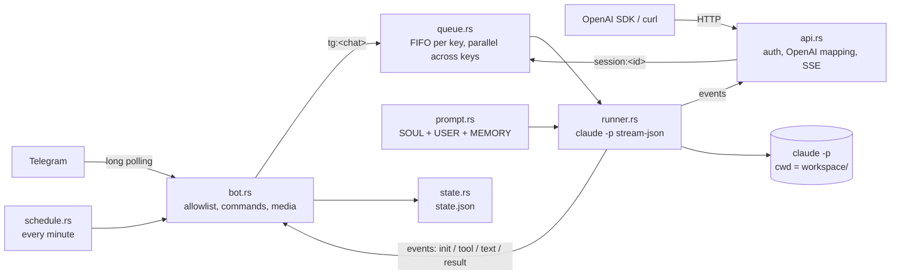

# Architecture

One binary, `cc-gateway`, does both jobs. CLI commands manage profiles, keys and services. `cc-gateway run <profile>` is the daemon: it starts the profile's enabled gateways, and they share one set of job queues.

## One run, end to end

1. **In:** a Telegram message from an allowlisted user (photos, documents and voice notes are downloaded or transcribed first), a cron job, or an authenticated API request.
2. **Queue:** jobs with the same key run in order (`tg:<chat>`, `session:<id>` for API requests that resume a session, a unique key for new ones); different keys run in parallel. The API also takes a slot from the `max_concurrent` semaphore. Idle workers exit.
3. **Prompt:** `prompt.rs` rebuilds the system prompt every time from `SOUL.md`, the user's or key's `USER.md` and `MEMORY.md` (with their paths, so Claude can edit them), and memory rules. For Telegram it adds the outbox path; for the API it adds the client's system messages.
4. **Spawn:** `runner.rs` runs `claude -p --output-format stream-json --verbose --append-system-prompt … --dangerously-skip-permissions --model … --max-turns … [--resume <id>] -- <prompt>` as an argument list in its own process group, with the profile `workspace/` as cwd.
5. **Stream:** each stdout line is parsed defensively into `Init(session_id)`, `Tool{name,input}`, `Text`, or `Result{text, session_id, cost, tokens, is_error}`. Unknown events are ignored. Telegram turns tool events into the live status message; the API turns them into SSE.
6. **Finish:** once `result` arrives, the answer goes out without waiting for stdout to close. Timeout, stop or shutdown kill the whole process group. A `--resume` that points at a missing session is detected: Telegram clears it and retries once; the API returns 404.
7. **Persist:** every new session id is recorded with its owner in `sessions.json` (`tg:<chat>` or `key:<name>`); the API only resumes sessions owned by the requesting key. Telegram stores the chat's session id in `state.json`, written atomically (temp file + rename), unless `/new` was sent while the job was running. Outbox files are sent, then deleted.

## Modules

| File | Role |
|------|------|
| `main.rs` | clap CLI, home migration, `run` (starts the gateways, signal handling), logging |
| `bot.rs` | Telegram gateway: dispatcher, allowlist gate, chat commands, job execution, MarkdownV2, outbox, 409 hint |
| `api.rs` | API gateway: axum routes, key generation/hashing, OpenAI request/response mapping, SSE, run registry |
| `runner.rs` | Spawn claude, parse stream-json, timeout/stop, process-group kill, shutdown kill-all |
| `queue.rs` | Per-key FIFO workers with stop handles and `/stop` generations |
| `prompt.rs` | System prompt assembly |
| `profile.rs` | Paths, `config.toml` (0600, atomic), profile lock, pair codes, migration |
| `state.rs` | `state.json` atomic persistence, compare-and-set session storage, `sessions.json` session owners |
| `media.rs` | Telegram downloads, ffmpeg + whisper-cli transcription |
| `schedule.rs` | 5-field cron (standard weekday numbering, dom/dow OR), minute loop |
| `service.rs` | launchd plist / systemd template unit |
| `setup.rs` | Wizard, non-interactive setup, doctor, keys, pair, Hermes import flow, update/uninstall |
| `hermes.rs` | Hermes home detection, `.env`/`config.yaml` parsing, file and skill import |

## Concurrency and safety details

- `config.toml` and `pair.json` read-modify-writes, in both the daemon and the CLI, hold an exclusive `flock` on `<profile>/.lock`. Writes use unique temp files followed by an atomic rename.
- The API authenticates in middleware (before reading the body) and re-reads `config.toml` for every request (keys); Telegram re-reads it for every message (allowlist).
- Each claude process group id is tracked; SIGTERM or SIGINT kills them all before exit.
